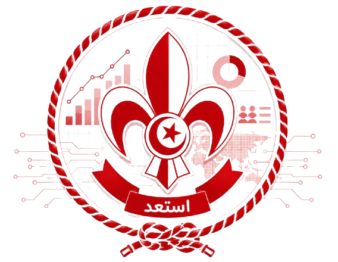
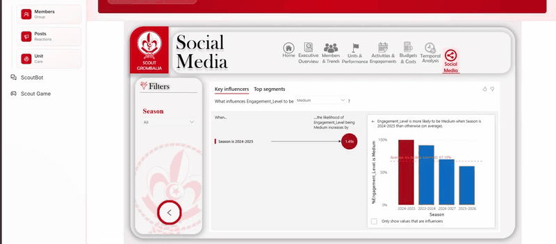
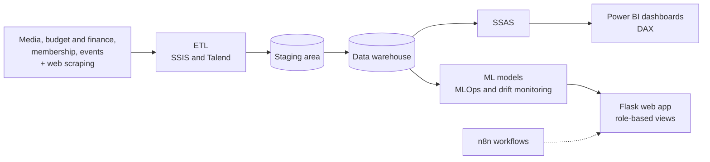
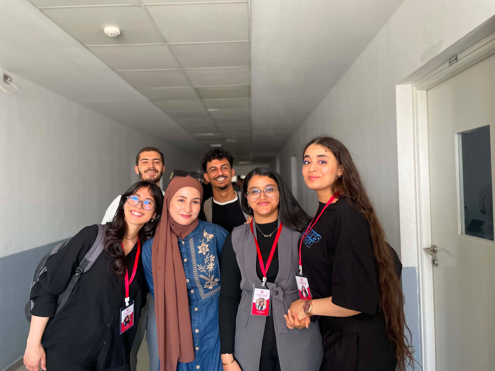

  

# Scouts Grombalia Decision Support System

**From raw data to dashboards, forecasts and role-based views for a scout group's leaders.**

*Team project at ESPRIT, built with the GIMSI methodology, 2026.*

> The source code for this project is private. The full demo video is on my portfolio: **[roua-slama-portfolio.netlify.app](https://roua-slama-portfolio.netlify.app/#scouts)**.

## The problem

A scout group's data is scattered: media posts, budgets and finance, memberships and events live in different places. Leaders have no single view to plan the next season. This project brings everything into one data platform and gives each leader the numbers and forecasts that matter for their role.

## What it does

- **Data foundation.** A staging area and a data warehouse covering media, budget and finance, membership and events. ETL pipelines built with SSIS and Talend, with datasets enriched by web scraping.
- **Power BI dashboards** with DAX measures: executive overview, members and trends, units and performance, activities and engagement, budgets and costs, temporal analysis and social media.
- **Machine learning.** Models trained and evaluated for forecasting, with MLOps pipelines and drift monitoring.
- **Role-based web app (Flask).** Group leaders, finance managers and unit leaders each see only the pages that fit their role, and an admin approves access requests. It includes planning tools such as an activity budget estimator, a members and posts forecast, a scouting Q&A chatbot and a quiz game.
- **Automation.** Workflows automated with n8n.

## Architecture

## Stack

SQL · SSIS · Talend · SSAS · Power BI (DAX, Power Query) · Python · Scikit-learn · n8n · Flask

## The team

  

<em>The team behind the project.</em>

## Contact

Roua Slama, Computer Science Engineering student at ESPRIT (BI & ERP), looking for a PFE in 2027.
[LinkedIn](https://linkedin.com/in/roua-slama) · [Portfolio](https://roua-slama-portfolio.netlify.app/) · slamaroua10@gmail.com
